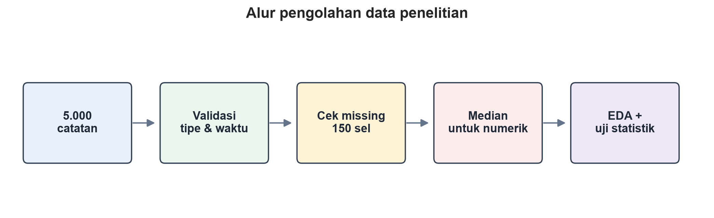
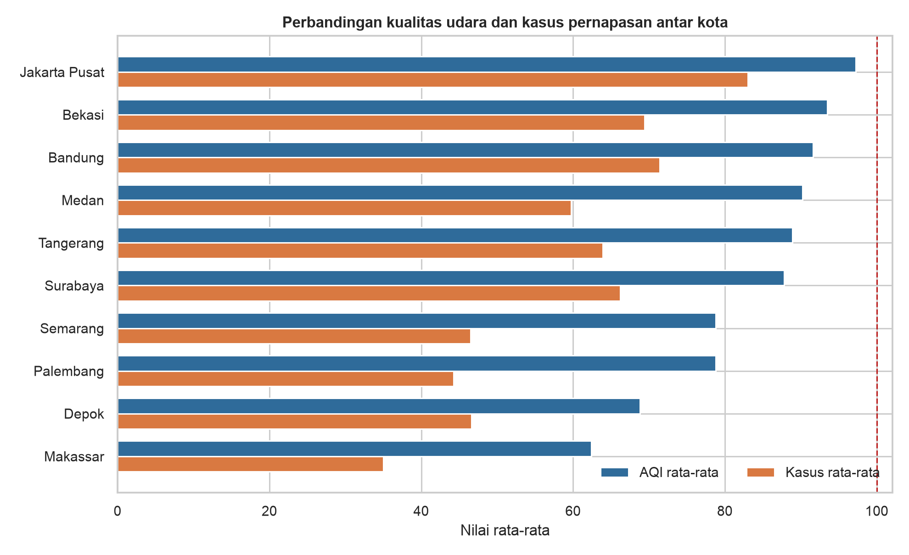
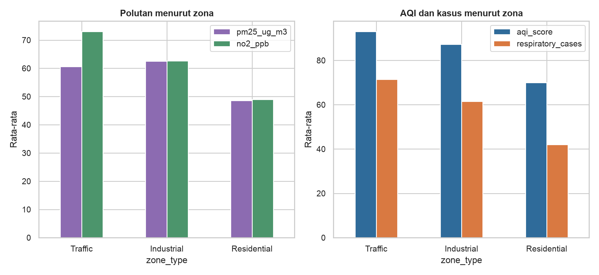
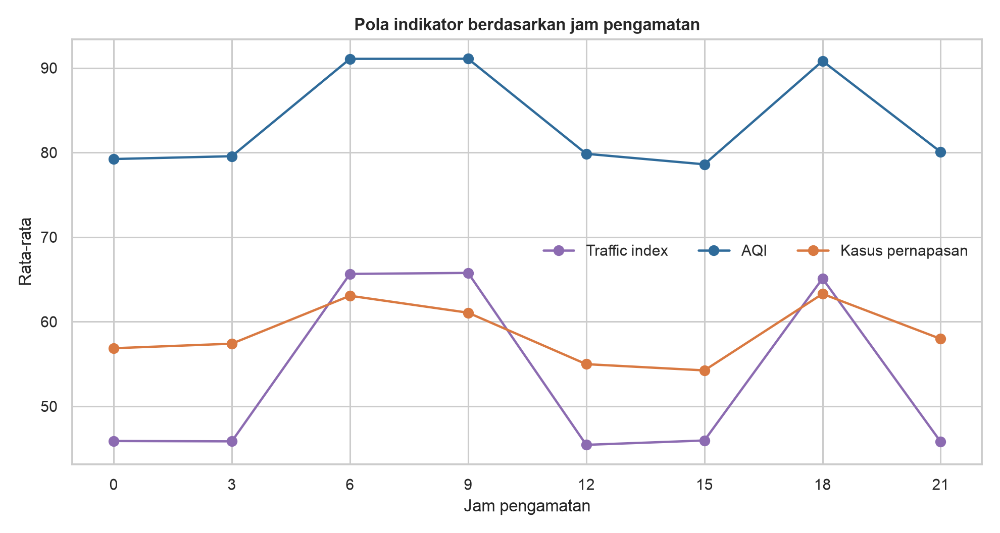
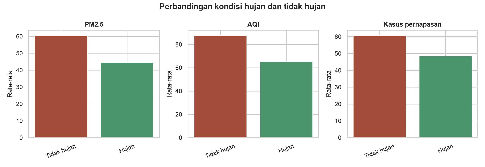
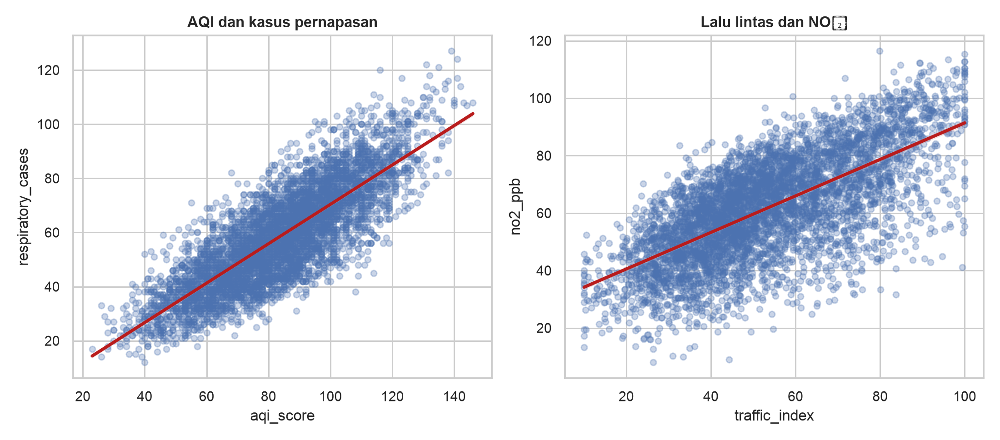

# Analisis Risiko Gangguan Pernapasan Berdasarkan Kualitas Udara, Meteorologi, dan Mobilitas Perkotaan di Indonesia

[](https://colab.research.google.com/github/mumtazka/print-group-3org/blob/main/analisis_kualitas_udara_dan_kesehatan.ipynb)


> **Catatan untuk Dewan Juri:**  
> Repositori ini disusun untuk kompetisi **PRINT 2026 (Data Analytics - Lingkungan)**.  
> Untuk menjalankan notebook langsung di cloud tanpa instalasi lokal, silakan klik tombol **Open In Colab** di atas (pastikan mengganti link dengan username/repo GitHub tim ini).

---

## 👥 Profil Tim (PRINT Group 3org)

* **Ravi Rinakit Kurniawan** — 24060126140167
* **Meilan Malik Lutfi Prasetyo** — 24060126140154
* **Mumtaz Kholafiyan Alfan** — 24060126130062

---

## 📌 Ringkasan Eksekutif

Pencemaran udara di kawasan perkotaan meningkatkan risiko gangguan kesehatan, khususnya jika didorong oleh mobilitas transportasi padat dan dispersi atmosfer yang rendah. Proyek ini menganalisis **5.000 observasi** pemantauan lingkungan, lalu lintas, dan kesehatan pernapasan di **10 kota besar Indonesia** dengan interval pencatatan 3 jam (25 Agustus – 26 Oktober 2026).

### Temuan Utama:
1. **21,42% Observasi Masuk Kategori Berisiko (AQI > 100):** Rata-rata laporan gangguan pernapasan melonjak drastis dari **52,82 kasus** pada kondisi AQI aman menjadi **79,91 kasus** pada kondisi berisiko (*p < 0,001*, uji Mann-Whitney U).
2. **Karakteristik Wilayah Berbeda:**
   - **Jakarta Pusat** mencatat rata-rata AQI tertinggi (97,23) dan laporan kasus pernapasan tertinggi (83,02).
   - **Zona Traffic** memiliki NO₂ tertinggi (73,03 ppb), AQI tertinggi (93,03), dan kasus pernapasan tertinggi (71,39).
   - **Zona Industrial** mendominasi polutan partikulat PM2.5 tertinggi (62,53 µg/m³).
3. **Efek Pencucian Alami oleh Hujan:** Kejadian hujan menurunkan rata-rata PM2.5 dari 60,55 menjadi 44,55 µg/m³ serta menurunkan AQI dari 87,69 menjadi 65,30 (korelasi Spearman $r = -0,413$).

---

## 📂 Struktur Repositori

```text
├── README.md                                    # Dokumentasi proyek, temuan utama, & insight
├── analisis_kualitas_udara_dan_kesehatan.ipynb # Jupyter Notebook LENGKAP (kode + visualisasi)
├── requirements.txt                             # Dependensi Python
└── assets/                                      # Visualisasi grafik hasil analisis
    ├── fig01_alur_cleaning.png                  # Alur data cleaning & imputasi
    ├── fig02_kota.png                           # Variasi spasial 10 kota
    ├── fig03_zona.png                           # Profil risiko menurut tipe zona
    ├── fig04_temporal.png                       # Pola temporal harian per jam
    ├── fig05_hujan.png                          # Dampak kondisi hujan vs tidak hujan
    └── fig06_hubungan.png                       # Korelasi antarvariabel polusi, mobilitas, & kesehatan
```

---

## 🧹 1. Pipeline Pembersihan Data (Data Cleaning)

Dari 35.000 sel numerik, hanya ditemukan 150 sel data kosong (0,43%) yang terbagi merata pada 3 variabel: `temperature_c` (50 baris), `traffic_index` (50 baris), dan `pm25_ug_m3` (50 baris). Seluruh missing values ditangani secara transparan menggunakan **imputasi median kolom** karena sifat data yang tidak simetris (skewed) dan ketahanan median terhadap outlier.



*Gambar 1. Alur pengolahan data dan keputusan penanganan missing value.*

---

## 📊 2. Eksplorasi Data & Temuan Utama (EDA)

### A. Variasi Spasial Antar Kota
Terdapat disparitas risiko yang signifikan antar kota:
* **Risiko Tertinggi:** Jakarta Pusat memimpin rata-rata AQI (97,23) dan laporan kasus gangguan pernapasan (83,02 kasus). Bekasi memimpin rata-rata konsentrasi PM2.5 tertinggi (68,25 µg/m³).
* **Kualitas Udara Terbaik:** Makassar memiliki rata-rata AQI terendah (62,39) dengan rata-rata 35,02 kasus pernapasan.



*Gambar 2. Perbandingan AQI dan laporan gangguan pernapasan antar 10 kota (garis putus-putus = ambang batas aman AQI 100).*

---

### B. Karakteristik Risiko Berdasarkan Tipe Zona
* **Zona Traffic:** Didorong oleh emisi kendaraan bermotor dengan NO₂ tertinggi (73,03 ppb), AQI tertinggi (93,03), dan kasus pernapasan terbanyak (71,39 kasus).
* **Zona Industrial:** Memiliki partikulat PM2.5 tertinggi (62,53 µg/m³), mengindikasikan emisi pembakaran pabrik/industri.
* **Zona Residential:** Menunjukkan tingkat paparan terendah (AQI 70,00 dan kasus pernapasan 41,98).



*Gambar 3. Profil polutan, AQI, dan laporan gangguan pernapasan berdasarkan tipe zona.*

---

### C. Pola Temporal Jam Pengamatan
Lonjakan kepadatan lalu lintas terjadi pada jam sibuk kerja:
* **Pagi hari (06.00 – 09.00):** Traffic index mencapai puncak (65,65 – 65,77) diikuti kenaikan AQI ke angka ~91.
* **Sore hari (18.00):** Kasus gangguan pernapasan mencapai puncak rata-rata tertinggi (63,30 kasus) bersamaan dengan jam kepulangan lalu lintas sore.



*Gambar 4. Pola rata-rata lalu lintas, AQI, dan laporan gangguan pernapasan menurut jam pengamatan.*

---

### D. Peran Curah Hujan sebagai Pembersih Alami
Hujan berperan penting dalam proses *wet deposition* (pencucian atmosfer):
* Rata-rata PM2.5 turun dari **60,55** (saat kering) menjadi **44,55 µg/m³** (saat hujan).
* Laporan kasus gangguan pernapasan turun rata-rata 20% dari **60,75** menjadi **48,52 kasus**.



*Gambar 5. Perbandingan indikator polusi dan laporan pernapasan pada kondisi hujan vs tidak hujan.*

---

### E. Analisis Asosiasi & Hubungan Antarvariabel
Kepadatan kendaraan bermotor terbukti berasosiasi erat dengan lonjakan gas NO₂ ($r = 0,664$), dan peningkatan indeks polusi udara (AQI) memiliki korelasi linear kuat dengan lonjakan laporan gangguan pernapasan ($r = 0,811$).



*Gambar 6. Hubungan korelasi AQI dengan laporan pernapasan serta Traffic Index dengan NO₂.*

---

## 🧪 3. Pengujian Hipotesis Statistik

Untuk menguji signifikansi temuan tanpa asumsi normalitas berlebihan, dilakukan serangkaian uji non-parametrik ($\alpha = 0,05$):

| Pengujian Statistik | Metode | Hasil Uji | Nilai Signifikansi | Kesimpulan |
|---|---|---|---|---|
| **Kasus Pernapasan pada AQI Aman vs Berisiko** | Mann-Whitney U | 52,82 vs 79,91 kasus | $p < 0,001$ | **Signifikan:** Kondisi udara berisiko berhubungan langsung dengan lonjakan laporan pernapasan. |
| **Perbedaan Kasus Antar Tipe Zona** | Kruskal-Wallis | Traffic > Industrial > Residential | $p < 0,001$ | **Signifikan:** Karakteristik zona memiliki distribusi risiko kesehatan yang berbeda nyata. |
| **Korelasi AQI vs Kasus Pernapasan** | Spearman Rank | $\rho = 0,811$ | $p < 0,001$ | **Sangat Kuat Positif:** Kenaikan AQI sejalan dengan peningkatan kasus pernapasan. |
| **Korelasi Curah Hujan vs AQI** | Spearman Rank | $\rho = -0,413$ | $p < 0,001$ | **Moderat Negatif:** Curah hujan efektif mereduksi konsentrasi polutan udara. |

---

## 💡 4. Rekomendasi Kebijakan Berbasis Data (*Actionable Recommendations*)

1. **Sistem Peringatan Dini Dinamis (Early Warning System):**
   Aktivasi peringatan otomatis bagi kelompok rentan saat AQI > 100, khususnya pada jam rawan mobilitas pagi (06.00–09.00) dan sore (18.00–21.00).
2. **Manajemen Koridor Transportasi di Zona Traffic:**
   Fokus pada pengendalian emisi gas NO₂ melalui uji emisi berkala, rekayasa lalu lintas saat jam sibuk, serta elektrifikasi transportasi umum di kota berisiko tinggi (Jakarta Pusat, Surabaya).
3. **Pengawasan Emisi Partikulat di Kawasan Industri:**
   Pemasangan sensor partikulat PM2.5 real-time di sekitar zona industri (khususnya wilayah Bekasi dan sekitarnya) yang terhubung langsung ke dinas lingkungan hidup.
4. **Integrasi Data Lingkungan & Fasilitas Layanan Kesehatan (Faskes):**
   Membangun dashboard bersama antara dinas lingkungan dan faskes untuk mengantisipasi lonjakan kebutuhan obat dan kapasitas ruang rawat pernapasan saat episode polusi tinggi terjadi.
5. **Kontekstualisasi Faktor Cuaca dalam Protokol Siaga:**
   Memanfaatkan prakiraan BMKG; kewaspadaan ditingkatkan berlipat ganda saat musim kemarau atau periode tanpa hujan berkepanjangan.

---

## 🚀 5. Cara Menjalankan Notebook

### Opsi 1: Google Colab (Paling Mudah)
Klik tombol badge **Open In Colab** di bagian paling atas dokumen ini, atau buka file `analisis_kualitas_udara_dan_kesehatan.ipynb` langsung di Google Colab.

### Opsi 2: Lokal (Jupyter Notebook / VS Code)
1. Clone repositori ini:
   ```bash
   git clone https://github.com/mumtazka/print-group-3org.git
   cd print-group-3org
   ```
2. Buat virtual environment & install dependensi:
   ```bash
   python -m venv venv
   source venv/bin/activate  # Untuk Windows: venv\Scripts\activate
   pip install -r requirements.txt
   ```
3. Jalankan notebook:
   ```bash
   jupyter notebook analisis_kualitas_udara_dan_kesehatan.ipynb
   ```

---
*Dikembangkan oleh **PRINT Group 3org** untuk Lomba Data Analytics PRINT 2026.*
